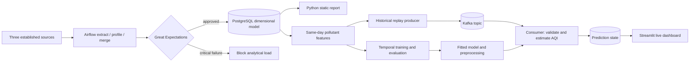

# Air quality in India: analytical reporting and Kafka inference

**Authors:** Samuel Flores and Santiago Becerra · ETL G51

This final delivery extends the earlier India air-quality project. It preserves the original measurements, EDA notebooks, three-source Airflow pipeline, Great Expectations checks and PostgreSQL dimensional model. The new components train an AQI estimation model, replay each city's daily pollutant readings through Kafka, apply the saved model in a separate consumer to estimate that day's AQI and CPCB category, and present the estimates in a live dashboard.

The model was redesigned after the first evaluation: a next-day AQI forecast did not beat a constant-mean baseline because the data contain no day-to-day persistence (section 5). The final run completed all twelve Airflow tasks. Its quality checks, model evaluation and Kafka demonstration are recorded in [the execution results](resultados_final.md). Model metrics and held-out predictions are saved in `artifacts/metadata.json` and `artifacts/test_predictions.csv` and interpreted in the static report.

## 1. Project evolution and source roles

The first delivery organized 18,265 daily measurements from five cities—Bangalore, Chennai, Delhi, Kolkata and Mumbai—covering 2015–2024. The first-delivery SQLite database and notebooks are retained. The second delivery added city coordinates and historical weather, orchestration, quality validation and a PostgreSQL star schema. The final delivery adds a second consumption path rather than replacing this analytical foundation.

The sources have distinct roles:

1. **Air-quality measurements:** extracted with SQL from the preserved first-delivery SQLite database. The original Kaggle source supplies AQI, its original category and pollutant measurements.
2. **City coordinates:** extracted from the five Wikipedia city pages, stored in a small SQLite dataset and queried by the DAG. They connect the city identifiers to weather requests. Five coordinate rows are geographic enrichment, not an independent measurement series.
3. **Public API:** Open-Meteo historical ERA5 weather, requested by city and year. Daily mean temperature, precipitation and maximum wind are joined to air measurements by city and local calendar day. Responses, parameters and extraction timestamps are retained in the API cache/provenance records.

Coordinates join many-to-one by `city_id`; weather joins one-to-one by `city_id,date`. Left joins preserve the original observations and fail when weather does not match. Original dates are assumed to represent local days in India. ERA5 grid coordinates can differ from the requested city coordinates, and neither identifies a colocated pollution-monitoring station.

## 2. Updated architecture

The Mermaid source is `docs/arquitectura_final.mmd`.

The consumer never queries the analytical database. The dashboard reads the prediction state produced by the consumer. Only the producer, training process and static reporting process need the dimensional warehouse.

## 3. Airflow, transformation and quality

The original nine-task DAG `etl_calidad_aire_india_enriquecido` is preserved in `dags/dag_india.py`. The final DAG `etl_india_final` extends it to twelve tasks: `preparar_ejecucion`, `extraer_primera_entrega_sqlite`, `extraer_dataset_ciudades_bd`, `extraer_api_clima`, `eda_tres_fuentes`, `transformar_integrar`, `validar_great_expectations`, `cargar_data_warehouse`, `visualizar_desde_warehouse`, `entrenar_modelo`, `reporte_estatico` and `publicar_kafka`.

Preparation unpacks the preserved first delivery when necessary and initializes the execution. Air extraction and coordinates can run independently; weather waits for coordinates. Profiling waits for all sources, followed by merge, validation and loading. The load enables both the earlier warehouse visualizations and model training. Training must succeed before the final static report and finite Kafka replay run. A DAG execution trains a model once for its loaded snapshot; messages do not trigger retraining. The consumer and dashboard run separately as continuous applications.

The schedule is daily with `catchup=False` and `max_active_runs=1`. Default retries are zero; HTTP requests implement bounded retries for transient response codes. The historical CSV is a fixed snapshot: a daily run refreshes/checks enrichment and reloads the snapshot; it does not imply a new day of air measurements. `compose.yaml` keeps newly discovered DAGs paused so that starting the demonstration does not automatically launch unexpected historical API work.

Transformations parse calendar dates, enforce numeric measures, retain original city identifiers and AQI categories and add weather provenance. No outlier is removed solely because an IQR rule flags it. No undocumented pollutant unit is invented.

Great Expectations checks exact row count, required values, unique measurement and city/day keys, permitted cities/categories, historical dates, geographic ranges and physically admissible values. An additional check verifies the complete city/day coverage. A failed critical validation raises an exception; default `all_success` dependencies prevent the load from running. Approval records include the validated CSV hash, which the loader checks before publication.

The loader replaces the historical snapshot within one PostgreSQL transaction. Failed loads roll back; repeated successful runs do not append duplicate facts. Run approval and load provenance are stored in `india_dw.etl_runs`. The earlier EDA notebooks remain in `notebooks/`; they are part of the portfolio history.

## 4. Dimensional model and event grain

`sql/warehouse.sql` defines `india_dw.fact_air_quality`, `dim_city`, `dim_date`, `dim_aqi`, `etl_runs` and the joined view `air_quality_enriched`. The fact grain is one city on one historical day. The fact table retains AQI, pollutants, weather, source execution and geographic grid fields; primary/foreign keys, uniqueness and checks enforce structural constraints.

The metrics published to Kafka are the **pollutant readings of the fact table** (`pm25`, `pm10`, `no_value`, `no2`, `nox`, `nh3`, `co`, `so2`, `o3`) for one city on one day — the same grain as the fact table. A feature event represents one city-day whose readings have just arrived and requests an estimate of that day's AQI. The observed AQI of the day (also in the fact table) is used only for offline supervised training/evaluation and is never published as an inference feature.

## 5. Prediction problem and reproducible evaluation

**First approach and why it was replaced.** The first model forecast next-day AQI from the previous day's AQI, pollutants, weather and calendar. On 2023–2024 it reached MAE 98.8 AQI points, no better than always predicting the mean (98.7; R² ≈ 0). We then measured whether the data could support any forecast: in the training period the lag-1 autocorrelation of AQI is between −0.02 and 0.02 in every city and monthly average AQI varies by only a few points. Past values carry no information about tomorrow, so a next-day forecast is not defensible with this dataset. This evidence is recomputed during training and stored in `metadata.json` under `forecastability`.

**Final objective.** Estimate the AQI of a city on a given day, and its CPCB category, from the pollutant readings of that same day. Operationally this lets a monitoring centre publish an AQI value and category as soon as the sensors report, before the official calculation is released. The official AQI is the maximum of piecewise sub-indices per pollutant, so the relationship is strong but non-linear.

`src/final_ml.py` shares feature engineering with the producer. The ordered inputs are `city_name`, `pm25`, `pm10`, `no_value`, `no2`, `nox`, `nh3`, `co`, `so2` and `o3`, all from the same city-day. Missing, negative, non-finite or invalid source values are rejected rather than silently imputed.

All cities use common date partitions: training through 2021, validation in 2022 and untouched test in 2023–2024. Ridge regression, HistGradientBoosting and Random Forest are fitted on training and compared by validation MAE. Only the selected configuration is refitted on training plus validation. Test performance is then reported without selecting a model or hyperparameter on test data.

The fitted pipeline combines numeric `StandardScaler`, city `OneHotEncoder` and the regressor. The selected model is compared with the development-period mean AQI and with the linear model. Reported metrics are MAE, RMSE, R² and **category accuracy** (share of city-days whose estimated CPCB category equals the observed one), overall and by city. The measured values are in [the execution results](resultados_final.md) and `artifacts/metadata.json`.

`artifacts/model.joblib` contains the fitted pipeline (compressed). `metadata.json` documents features, dates, selection rule, source execution IDs, dataset/model hashes, package versions, test scores, forecastability evidence and limitations. `test_predictions.csv` preserves actual and estimated AQI and categories for audit. The model is loaded once when the consumer starts; inference calls `predict()` and never `fit()`.

## 6. Kafka contract, producer and consumer

The default topic is `india.aqi.features.v1`, with one partition for an easily inspected academic replay. Messages use JSON UTF-8 and the city identifier as Kafka key. The schema identifier is `india.aqi.nowcast.v1`.

| Field | Meaning |
|---|---|
| `schema_version` | Exact supported event schema |
| `event_id` | UUID derived from replay ID, source run, city and origin date |
| `published_at` | Timezone-aware publication timestamp, distinct from historical dates |
| `replay_id`, `simulation` | Replay identity and explicit `true` simulation marker |
| `origin_date`, `target_date` | Historical local day of the readings and day whose AQI is estimated (the same day) |
| `city_id`, `source_measurement_id`, `source_run_id` | Dimensional and ETL provenance |
| `features` | `city_name` and the nine pollutant readings expected by the fitted pipeline |

`src/final_stream.py produce` reads the approved warehouse, builds the shared features and publishes records in target-date/city order. Start/end dates, delay, maximum record count and replay ID are configurable. The producer enables idempotence, requests all acknowledgments and checks delivery callbacks and final flush. Reusing a replay ID with the same source run recreates the same event identifiers; a different replay ID represents a new demonstration.

The consumer validates schema, required/extraneous fields, identifiers, dates, city, finite numeric types and non-negative readings. Invalid messages are recorded in `rejected_events`. Valid messages generate one finite prediction saved in SQLite `predictions`, including the original event, model version, processing time, topic, partition and offset.

Auto commit is disabled. The offset is committed only after the result or rejection is durable. A crash after SQLite commit but before Kafka commit can cause redelivery; a primary key on `event_id` prevents duplicate predictions. This is idempotent processing under at-least-once delivery, not a distributed exactly-once transaction. An inference/storage failure is not acknowledged as successful. The local single-consumer store is an academic design, not a high-availability service.

## 7. Two forms of consumption and value

**Analytical path.** `src/final_report.py` queries the approved dimensional database in one consistent read-only transaction, reconciles approval metadata and checks coverage. It creates `reports/final/report.html` with four figures and supporting CSV/JSON exports. The report answers which cities have higher average AQI, how monthly values vary, how frequent original categories are, how weather relates to AQI within each city and how accurately the model estimates AQI compared with the baselines, including why a next-day forecast is not supported. Findings describe this historical dataset; they do not establish causality or current conditions. This path supports reproducible comparison and offline review.

**Operational path.** The consumer reacts to each city-day's pollutant readings, applies the stored pipeline and maintains the state of AQI estimates. `app/dashboard.py` reads only this output using a Streamlit fragment every two seconds. It displays stored estimates, rejected-message count, latest processing time, a city filter, estimated AQI by measurement date, the distribution of estimated CPCB categories, the model's test accuracy and the latest results with Kafka/model provenance. The displayed window is limited to the last 1,000 predictions; counters cover the store. This path demonstrates timely processing and visibility after each historical observation is replayed.

## 8. Execution and verification

The repository root contains `compose.yaml`; detailed setup commands are in [README_FINAL.md](../README_FINAL.md). PostgreSQL and Kafka are local services. The host endpoints are `localhost:55432` for PostgreSQL and `localhost:19092` for Kafka; container applications use service names and internal ports. The optional Airflow UI binds to local port 8088; the dashboard binds to local port 8502.

The normal dependency order is: start dependencies; prepare the preserved first delivery; run the final DAG to extract, validate, load, train, generate the report and publish a bounded replay. Its publication task sends the first 100 selected historical feature rows from 2023–2024, in target-date/city order, with a 0.1-second delay and uses the DAG execution ID as replay ID. A consumer can read retained events after the DAG finishes; start the consumer/dashboard before a separate paced replay to demonstrate visible arrivals. The CLI also exposes each new component separately for diagnosis and reproduction.

The live path requires real Kafka, a matching model/metadata pair and access to the shared prediction store. Restoring and verifying the earlier SQL snapshot is an alternative reproduction path when fresh source extraction is unavailable, followed by the standalone training/reporting/stream commands. This is a restoration of earlier evidence, not evidence that a fresh extraction or DAG ran today.

`notebooks/04_demo_streaming.ipynb` offers an optional local Jupyter demonstration after these prerequisites. It launches separate Python processes, uses a fresh demo topic/replay, shows real prediction-store rows and provides cleanup. It requires the configured PostgreSQL and Kafka services; an ordinary Google Colab runtime does not provide this local Docker setup. Prior Colab notebooks are preserved for their original scope.

The verification of the first version (22–23 November) passed 25 unit tests and 21 audit checks; the results of the final model's run are in [the execution results](resultados_final.md). The quality-gate test blocked negative precipitation and a CSV changed after approval without modifying the warehouse. A separate Kafka integration test processed 20 valid records, 20 redeliveries and three invalid messages, then checked stored predictions and committed offsets. The dashboard check observed its count increase from 100 to 150 on the same open page. The scripts `tests/audit_final.py` and `tests/integration_final.py` reproduce the audit and Kafka checks; [the execution results](resultados_final.md) link their saved evidence and the executed notebooks.

## 9. Assumptions and limitations

The original Kaggle source does not establish every pollutant unit or monitoring-station provenance. India-local calendar alignment is an explicit assumption inherited from the earlier delivery. ERA5 is historical reanalysis used in the analytical path. The model supports five cities and this fixed period. It estimates the current day's AQI and is not a forecast; the data do not support next-day forecasting. It reproduces the relationship between readings and AQI learned from 2015–2022, so a change in the official formula or sensor calibration requires retraining.

The stream is an accelerated historical replay, not current environmental monitoring. Predictions are an academic experiment and must not be treated as a validated public warning system. The local KRaft broker has one node, replication factor one and no availability guarantee. Demo service settings are scoped to local development; the project does not implement CDC, a production model registry, drift-triggered retraining, broker failover or a production deployment. A successful final DAG execution does refit the model for its snapshot; an already running consumer must be restarted to load the replacement artifact.

