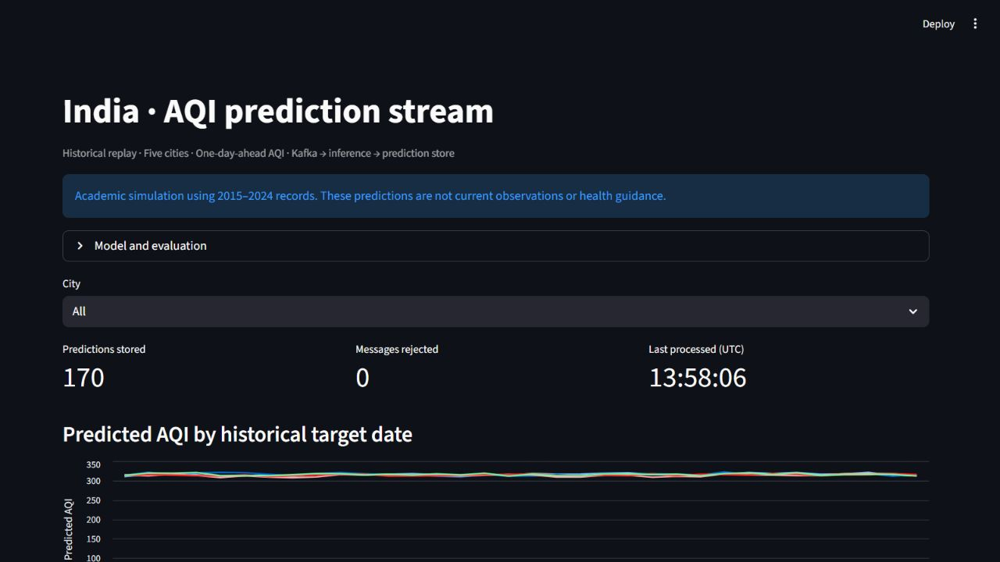

# Final-delivery verification — 23 and 24 November 2026

## Final run with the AQI estimation model — 24 November 2026

After the model was redesigned (see "Model evaluation"), the complete project was run again from a clean checkout in a GitHub Codespace with Docker Compose:

- Airflow run `manual__2026-11-25T00:00:00+00:00` completed all 12 tasks with no failures, including fresh extraction of the three sources, Great Expectations validation, warehouse load, training, the static report and a 100-event Kafka replay.
- 27 unit tests passed (`tests/test_final_ml.py`, `test_final_stream.py`, `test_final_report.py`).
- The Kafka integration test processed 43 messages: 20 valid events, 20 redeliveries ignored as duplicates and 3 invalid messages rejected; every prediction matched the serialized model and the warehouse was unchanged.
- The consumer recovery test and the audit (`tests/audit_final.py`) passed.
- Both final notebooks (`03_modelo_predictivo.ipynb`, `04_demo_streaming.ipynb`) executed without errors.
- The live consumer and Streamlit dashboard were restarted with the new model; the Airflow web interface showed the 12 green tasks.

Evidence: `evidencias/final/airflow_task_states.csv`, `audit.json`, `integration.json`, `recovery.json`, `validation.json` and `artifacts/metadata.json`.

## First verification — 23 November 2026

The new repository was tested in a separate Docker Compose project, `india-verification`, with a new PostgreSQL volume and a new Kafka broker. The earlier demonstration services were kept separate.

## ETL and data quality

Airflow run `manual__2026-11-23T00:00:00+00:00` completed all 12 tasks. The pipeline refreshed the Wikipedia coordinates, made fifty Open-Meteo HTTP requests and loaded 18,265 approved city/day records into PostgreSQL. The audit passed 21 checks. The original quality test rejected negative precipitation and a file modified after approval; the warehouse fingerprint stayed unchanged.

The scheduler, triggerer and metadata database returned healthy status. The DAGs stayed paused during the service test; this verification does not claim a continuous daily deployment.

Evidence: `evidencias/final/audit.json`, `airflow_task_states.csv`, `validation.json` and `services.json`.

## Model evaluation

Training used 2015–2021, selection used 2022, and the final fitted pipeline used 2015–2022. Testing used 2023–2024. The same feature function serves training and Kafka publication.

**First version: next-day forecast (23 November).** The model forecast tomorrow's AQI from the previous day's values.

| Test estimator | MAE | RMSE | R² |
|---|---:|---:|---:|
| Ridge model | 98.7733 | 114.1729 | -0.0015 |
| Development mean | 98.6803 | 114.0930 | -0.0001 |
| Previous-day AQI | 132.8741 | 162.5509 | -1.0301 |

It did not beat the constant mean. The data explain why: in 2015–2021 the lag-1 autocorrelation of AQI is between −0.005 and 0.033 in the five cities and monthly average AQI varies by only 10.9 points. Yesterday's AQI carries no information about tomorrow's, so the forecast was abandoned.

**Final version: same-day AQI estimation (24 November).** The model estimates the AQI of each city-day, and its CPCB category, from that day's nine pollutant readings. Validation MAE in 2022: Ridge 93.01, HistGradientBoosting 5.51, Random Forest 0.96 (selected), mean 96.71.

| Test estimator (2023–2024) | MAE | RMSE | R² | Category accuracy |
|---|---:|---:|---:|---:|
| Random Forest (selected) | 1.2062 | 9.1013 | 0.9936 | 98.9% |
| Linear reference (Ridge) | 95.5842 | 110.8087 | 0.0566 | 25.7% |
| Development mean | 98.6788 | 114.0929 | -0.0001 | 30.1% |

By city, test MAE ranges from 0.71 (Delhi) to 1.58 (Chennai) and category accuracy from 98.8% to 99.3%. The linear model fails because the official AQI is the maximum of piecewise sub-indices per pollutant, a non-linear relationship that tree ensembles capture. The model estimates the current day's AQI; it is not a forecast.

## Kafka, inference and recovery

The real-broker integration test processed 43 messages: 20 new valid events, 20 redeliveries and three invalid messages. It stored 20 predictions, ignored the duplicates and recorded all invalid messages before committing their offsets.

A separate test restarted the consumer with the same group and prediction store. It resumed at the committed offset, rejected a corrupt UTF-8 message and processed the following valid events. All four predictions matched both the fitted model and the exported offline predictions. An altered copy of the model was rejected before deserialization or creation of a result store. The original artifact and analytical warehouse were unchanged.

Evidence: `evidencias/final/integration.json` and `recovery.json`.

## Live dashboard and service restart

The dashboard showed 100 predictions from Airflow publication. Publishing another 50 events increased the counter to 150 without a page reload. The Compose services were then removed and recreated without deleting the PostgreSQL volume. The analytical dataset and the 150 stored predictions survived. After recreating the Kafka topic, another 20 events increased the same dashboard to 170.

The restart exposed a stale Airflow webserver PID file: a process number from the old container was reused by another process and blocked the webserver. `src/airflow_start.py` now removes that runtime PID before starting the single local Airflow service. A further restart passed with a new scheduler heartbeat and a healthy web interface.

Evidence: `evidencias/final/deployment_restart.json` and `services.json`.



## Corrections made during verification

- The audit copies evidence contents without trying to preserve host filesystem timestamps, which failed when overwriting files on the Windows Docker mount.
- The demonstration notebook checks port availability before starting processes and waits for Streamlit health before showing a link. Failed startup closes its own processes.
- The ML notebook checks that an existing model belongs to the current warehouse run.
- The README waits for service health and recreates the Kafka topic before starting the consumer after `down/up`.
- Airflow startup clears the stale PID described above. Its generated control socket is excluded from Git and Docker build context.

## Reproduce

The usual setup is in `README.md`. The isolated configuration used for this test is `tests/compose.verification.yaml`:

```sh
docker compose -p india-verification -f compose.yaml -f tests/compose.verification.yaml up -d --wait postgres kafka
docker compose -p india-verification -f compose.yaml -f tests/compose.verification.yaml build tools
docker compose -p india-verification -f compose.yaml -f tests/compose.verification.yaml run --rm tools airflow db migrate
docker compose -p india-verification -f compose.yaml -f tests/compose.verification.yaml run --rm tools airflow dags test etl_india_final 2026-11-23
```

Run the unit, audit, integration and recovery commands from the README using the same Compose options. All 25 unit tests passed, both new notebooks executed without errors, the exported database dump restored with 18,265 fact rows, and `pip check` reported no broken requirements. Notebook execution counts are recorded in `evidencias/final/notebooks.json`.

The isolated test exposes PostgreSQL on 55433, Kafka on 19093, Streamlit on 8503 and Airflow on 8089. The normal project retains the ports documented in the README.
